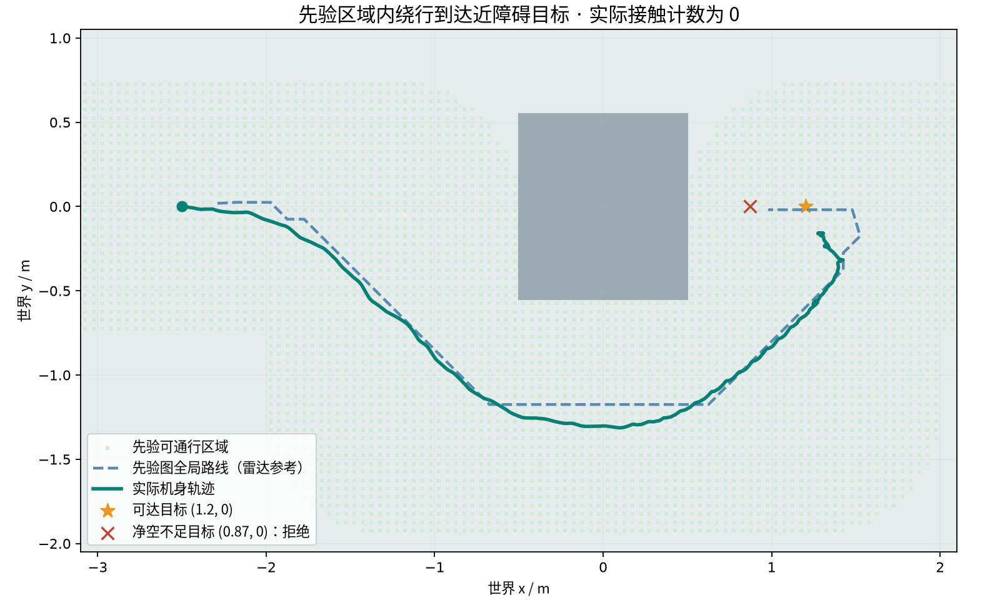

# 交互先验导航与近障碍目标修正 · 2026-10-28

当前本机入口：`python3 simulation/run_interactive.py --case large_obstacle`。
页面显示实时 Go2 动力学画面、绿色先验可通行区域、全局参考、局部曲线及实际机身轨迹；用户可连续点选目标、拖动最终朝向、停止、显式重置、结束测试。

## 问题与修改

之前的交互验证确实出现 3 次接触采样。旧仿真把箱体覆盖的地面也发布为 FREE，且选点后直接连接起终点，没有运行基于 FREE 的全局搜索。局部优化的原生碰撞处理主要覆盖滚动窗口，发布前只有完整先验检查，末端实时障碍检查存在缺口。

现在：

1. 仿真生成与场景匹配的**固定先验 FREE 体素**，箱体和未知区域不标通行。箱体场景展示一条经过障碍物下侧的已知通行走廊。先验以 0.05 m 分辨率保存/发布，界面按保守合并的绿色区域展示。
2. 复用项目 `map_for_plan/scripts/plan_graph.py` 的 `FreeGraph` 全局搜索代码，在同一先验内生成参考路线。边和连接段检查机身支撑及已知静态障碍净空，不能跨越先验缺口或直接穿箱体。
3. 用户点选的是机身中心目标，保持保存的雷达参考偏移换算。目标点自身净空不足或超出先验时明确拒绝，不静默吸附。可行的最终朝向接近段通过后才使用，否则保留侧向接近及现有末端位姿适配。
4. `checkSpatialFeasibility` 发布前统一检查整条最终曲线的原生双圆柱占据与先验，包括末端三分之一和终点。保留原生滚动优化、重规划优先、停车回执；未加入独立当前位置占用或整圈转向扫掠停车器。

矩形先验支撑名义尺寸仍为 0.70×0.35 m、余量 0.03 m；原生实时障碍圆柱仍为半径 0.25 m、前后偏移 ±0.18 m。未缩小机身，未降低碰撞约束，未更换原 site1 文件。

**地图范围：** 当前页面使用箱体测试场景配套的先验，不能将其当成原 site1 实景或实测机身/步态标定。原 site1 PCD/TUM 保持原样。本轮没有连接、修改或部署机器狗。

## 验证证据

- `4` 项交互 HTTP/目标输入检查、`4` 项先验拓扑/机身支撑检查、`4` 项末端反馈检查通过。
- 独立本机 C++ 回归：先验仅在这个单独测试进程中关闭，以隔离实时占据检查。前 2/3 曲线为空、障碍只在最后约 6% 时，整条曲线被真实 `SCANPlannerManager` 拒绝；空曲线空间被接受。正常交互导航仍强制先验。
- `(0.87, 0)`、朝向 0：目标位于箱体背后但名义机身放不下，HTTP 400，保持零命令、不发送路线。
- `(0, 2)`：物理场景有地面，但不在先验通行区，HTTP 400，不扩展先验。
- `(1.2, 0)`、朝向 0：沿下侧先验绕行并到达，接触计数为 0。
- 同一机身目标、朝向 π：增加可行最终接近段后到达，接触计数为 0；过程中有一次停车重规划，并非完全无停顿。
- 最新反向试验的 1561 帧实际位姿均满足同一先验与名义静态模型查询。
- 普通直行入口仍可执行并到达。过程中发现并修正了网格末段方向与目标朝向不一致导致的末端参考偏差。
- 停止和显式重置经实际交互验证；到达后会话保持运行，可继续选点。

初次反向试验曾因最终对向超时失败，初次新全局参考的直行试验曾用尽位置恢复次数；原始失败记录与修正后的结果均保留于[验证汇总](interactive_prior_fix/verification.json)。不能将本轮少量成功视为全部场景已经稳定或已经通过实机验收。楼梯、狭窄通道与动态障碍还需后续重复验证。

原始结果：`simulation/artifacts/prior_goal_validation_20261028/`、`prior_approach_validation_20261028/`。
本机 C++ 编译与源码/产物校验通过；测试专用 master 使用回环 11792，交互 master 使用回环 11791，均不启动真实底盘桥。
