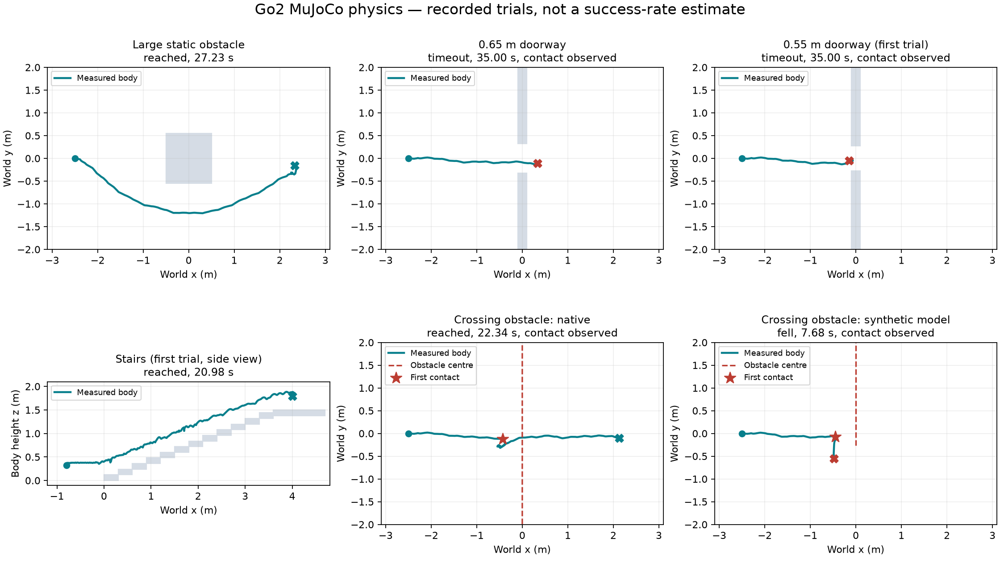

# 纯本机仿真 · 2026-10-28

**纯本机入口已跑通，但导航行为尚未全部通过，因此没有部署到机器狗。**

本组 10 次试验中，SCAN、闭环控制器、执行适配器、GNN、MuJoCo 全部运行在 xzq 本机 x86_64。
ROS master 使用 `http://127.0.0.1:11791`。每次记录的规划节点 URI 都是 `127.0.0.1`，远端连接列表为空，没有运行底盘桥。
本轮没有 SSH 连接、上传代码、重启服务或修改机器狗。

## 本轮结果

时间为包括约 2 秒静置在内的仿真时间。每场景一次，仅用于检查纯本机链路，不能作为统计成功率。

| 场景/模式 | 结果 | 接触情况与限制 |
|---|---|---|
| 直行/native | 到达，13.65 s | 无接触 |
| 最终朝向/native | 到达，26.41 s | 无接触 |
| 大障碍绕行/native | 到达，27.23 s | 无接触，需要一次位置恢复 |
| 65 cm 门洞/native | 超时，35 s | 肢体接触后停止，未通过 |
| 55 cm 门洞/native | 超时，35 s | 肢体接触后停止，未通过 |
| 楼梯/native | 到达，20.98 s | 无接触；先前试验不稳定，单次到达不等于已解决 |
| 走廊临时挡路后移开/native | 超时，45 s | 有接触，未完成 |
| 动态横穿/native | 碰撞后恢复到达，22.34 s | 有机身接触，不能算无碰撞避障通过 |
| 动态横穿/untrained | 失稳，7.86 s | 显式回退原规划器，无学习候选 |
| 动态横穿/learned | 失稳，7.68 s | 发出 29 个合成模型候选，均未成为成功使用的学习初值 |

学习权重仍为 20 场景、5 轮、80 步的流程验证模型，未证明导航收益。动态箱体碰撞后继续推挤，使用的 ONNX 步态也不能等同 Go2 Sport 的平衡和制动能力。
窄门摆腿接触、楼梯重复稳定性、动态预测和学习候选采用仍需在本机继续处理，未达到部署完成条件。



[本次楼梯实际状态回放](local_only/stairs_replay.png)。外围墙在离线画面中隐藏以便观察，测试时的物理碰撞场景没有改变。

## 变更与核验

- `run_case.py` 移除 Paramiko、SSH 认证、SFTP、远端启动与远端编译检查。所有工作由本机子进程完成，自动启动/清理独立 master。
- 默认不再需要原先的 ROS 终端、IP 地址或密码。拒绝非回环 master、默认硬件端口和旧 `--remote` 参数；保留操作者已有的 master 和其他端口上的进程。
- 新增独立 CMake 入口，用当前 SCAN 完整 C++ 源码生成本机消息、库和可执行文件。不使用先前工作区的旧二进制，也不替换生产 `nav/devel`。
- 补齐 `grid_map.h` 自身使用的 TF 类型头文件，规划算法、双圆柱尺寸、先验约束和目标容差均未修改。
- 本机 `cv_bridge` 使用固定官方提交构建，仅在生成副本中适配现代 Boost endian 头文件；未用假的图像转换或坐标转换实现绕过依赖。
- 3 项本机地址/入口约束检查通过，4 项最终朝向反馈回归检查通过；独立源码/二进制摘要校验通过。
- 全部试验结束后，本次 master 和节点已退出；之前操作者启动的 `192.168.31.9:11781` master 保留。

[完整试验汇总](local_only/summary.json) 保存运行架构、节点 URI、源码/输出校验值和失败记录。
[本机编译记录](local_only/build_manifest.json) 绑定本轮实际使用的源码、消息和二进制。
原始记录保存在 `simulation/artifacts/local_only_20261028/`，与历史混合运行记录分开。

## 复现

```bash
cd "/home/xzq/文档/ChatGPT/xie zq/replan_in_global_map"
python3 simulation/run_case.py --case stairs --mode native --duration 65 \
  --output "simulation/artifacts/my_stairs_$(date +%Y%m%d_%H%M%S)"
```

无需另开 ROS 终端或登录远端。源码修改后先执行 `python3 simulation/build_local.py`，再运行。
更多场景和离线画面指令见[运行说明](../../README.md)。
