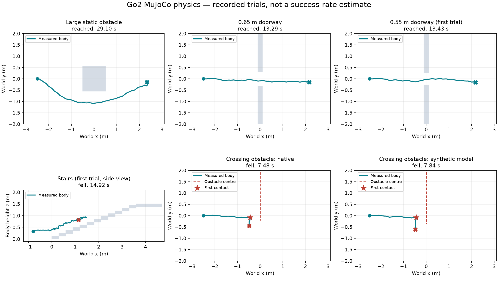

# Go2 动力学仿真记录 · 2026-10-28

**结论：基础行走、静态绕行和终点转向能完成；55 cm 窄门、楼梯及动态障碍尚未稳定通过。合成训练模型没有证明比原规划器更好。**

本次使用真实 MuJoCo 接触积分、自由基座和关节执行器，现有 Go2 ONNX 策略产生步态。
不是按 `/cmd_vel` 直接移动机身的运动学演示。规划端使用部署电脑上的 ARM64 SCAN、闭环控制器和执行适配器。
所有测试都连接独立 master `192.168.31.9:11781`，未启动真实 Go2 底盘桥或生产导航服务，原 site1 地图未替换。

## 修正输入后的主要结果

雷达使用随时间变化的 Mid360 模式，每 0.1 秒最多 4096 条射线。
使用保存的雷达到机身标定，保留 legacy 雷达导航参考点与 0.40 m 路径高度，双圆柱碰撞模型未缩小。
“到达”必须收到导航自己的 `goal_reached`，不以画面接近目标代替。
时间是包含约 2 秒启动静置的仿真总时间，不是纯规划耗时。

| 场景 | 配置与结果 | 接触与恢复 |
|---|---|---|
| 直行约 5 m | 原规划器，到达，13.51 s | 无障碍接触 |
| 终点转向约 166° | 修正后的执行适配器，到达，25.82 s | 无接触，最终机身位置误差约 8 mm、偏航误差 0.083 rad |
| 1.0×1.1×0.8 m 静态箱体 | 原规划器绕行到达，29.10 s | 无接触；需要一次终点位置恢复，尚非完全连续顺滑 |
| 65 cm 门洞 | 原规划器，到达，13.29 s | 无接触；本次只在修正扫描后试验一次 |
| 55 cm 门洞 | 第一次到达 13.43 s；第二次 35 s 超时 | 第二次肢体触墙后停车，不能算稳定通过 |
| 楼梯，12 级、级高 12 cm、踏面 30 cm | 三次分别：14.92 s 失稳、65 s 超时、23.65 s 到达 | 失稳前有机身接触；超时试验触发终点残差恢复，随后局部规划仍未恢复到达 |
| 80 cm 走廊内临时堵路，随后移开 | 40 s 超时 | 障碍移开后确实恢复并越过原阻挡位置；后续肢体碰墙，停止在终点附近 |
| 0.45 m/s 横穿箱体 | 原规划器：7.48 s 失稳；启用模块但无权重：7.66 s 失稳 | 接触后请求停止，但继续运动的障碍仍将机身推倒 |
| 同一横穿，加载小规模合成模型 | 7.84 s 失稳；另一次 DEBUG 诊断运行 35 s 超时、无接触 | 首次 29 个候选均未被实际采用；诊断运行采用了轨迹 2、5 的学习初值，但未到达目标 |

每场景次数很少，ROS 异步时序也会影响轨迹初始化与执行，以上是完整观测，不是统计成功率。DEBUG 诊断运行改变了日志与运行时序，不能把它和无 DEBUG 的单次试验用作性能优劣结论。

## 发现并修正的执行问题

1. **最终转向在容差边界反复启停。** 初次试验在约 42 s 因最终朝向超时而失败。改为在半个偏航容差内进入保持，超出完整容差才重新转向；若实测没有产生正确方向的转动，逐步补偿转向死区。最大转速 0.4 rad/s、角加速度 0.8 rad/s² 和最终偏航容差 0.12 rad 均保持原值。
2. **绕行后跟踪终点与实际机身目标的捕获条件不一致。** 允许匹配当前目标版本的规划跟踪终点进入最终对准；最终到达仍检查真实机身位置、朝向和静止反馈，残差超限仍需停车确认后恢复位置。修正后静态箱体试验可到达，但仍出现一次恢复。

执行适配器修正已同步到远端源码，没有重启生产导航。针对转向滞回、死区补偿上限、真实静止/机身容差、目标版本隔离，新增 **4 项回归检查，全部通过**。

## 学习模块测试

- 5 项契约检查全部通过，包含实际 PyTorch–NumPy 导出一致性；没有跳过该跨后端检查。
- 使用 20 个合成场景训练 5 轮，共 80 个优化步；验证损失 2.0908 → 1.5505。仅验证训练/导出/加载流程，没有真实障碍轨迹数据。
- 仿真模型 SHA-256：`354945938c5e688d7c33318ef3b2cf37e7924c640b06380b4df65adb7f328654`。没有上传到机器人生产模型目录，正常导航仍无部署权重并回退原规划器。
- 修正静态背景采样后，单个移动箱体场景正常显示约 1 个前景轨迹，修正了此前误检出大量背景轨迹的问题。
- 学习状态的限频上报样本中，本地 CPU 计算耗时约 13–33 ms；这不是全部调用的延迟分布，也不是 Jetson 推理性能。
- 候选已能经过 ROS 接口被规划端采用；采用与否还受年龄、端点连接和原生占据/先验检查约束。诊断日志记录过占据/先验拒绝。不能将“发布了候选”当成“成功用学习模型避障”。

## 未解决的问题与证据

**狭窄区域：** 55 cm 门洞的重复试验出现实际摆腿接触，不能只按约 35 cm 静态机身宽度推断可过。需要结合真实 Go2 步态的肢体包络、侧向跟踪误差和接触恢复继续处理，不应缩小碰撞模型来让测试通过。

**楼梯：** 失稳试验在约 12.88 s 出现接触并请求停车，之后侧倾超过 0.9 rad；另一次试验在终点对准后仍有约 0.238 m 机身残差，恢复过程中再次进入原生紧急保持。并非所有“停住”都来自同一个规划失败原因。

**动态障碍：** 原规划器、无权重回退、合成模型都未可靠完成横穿场景。至少需要真实轨迹训练、候选采用率与预测误差分析，以及更多闭环重复试验。当前不能声称 GNN 已带来提前预判收益。

**停止：** 动态横穿和楼梯接触后，保存的 50 Hz 反馈中下一帧已为零速度命令，约 20 ms；这是采样到的命令响应，不是实测物理制动时间。mocap 箱体碰撞后继续运动，仍会推倒已经被要求停止的机器人。

## 仿真有效范围

- 位姿来自真值，未测试 FAST-LIO、真实雷达噪声、网络丢包或真实接触传感器。
- 测试驱动提供全局参考路径，最多重新发布两次进行位置恢复；没有运行真实全局图搜索。
- 使用外部 ONNX 步态，未使用 Go2 Sport 控制器。停止时的支撑、抗推挤和楼梯稳定能力不能直接等同实机。
- 动态箱体是按轨迹移动的 mocap 刚体，碰撞后不会被机器人推开。
- 早期固定 2048 射线试验与新扫描输入不混算：早期 55 cm 门洞失败、楼梯曾成功，原始记录均保留在汇总中。固定射线影响旧障碍体素清除，背景整型坐标还曾引入前景误检；两项仿真输入错误已修正后重测。

## 记录与复现

[完整汇总与原始文件校验值](summary.json) 包含全部 26 次试验，包含失败、早期输入和 DEBUG 运行。
原始日志、事件、qpos、动态障碍状态、场景和轨迹保存在 `simulation/artifacts/20261028/`；早期少量试验未记录 qpos，汇总明确标出。
[运行说明](../../README.md) 提供独立入口与环境依赖。

[楼梯失败状态回放](stairs_replay.png) · [动态碰撞状态回放](dynamic_replay.png)。这些图由保存的真实仿真状态渲染，外围墙在离线画面中隐藏以便观察；不修改测试时的物理碰撞场景。

测试代码以 `b3550cef98207af25bdaf70bc317c363c5e8e6ef` 为基础，加上本次执行适配器补丁；汇总保存对应脚本摘要。
原始 `main`/`scan-native-baseline-20261028` 基线未覆盖。测试结束后仅为更新文档摘要重新编译并校验部署版本，测试期间使用的 C++ 规划源码没有改动。
